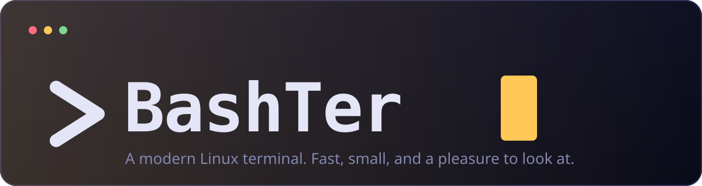

<div align="center">



<br/>

**A modern Linux terminal that is small, fast and genuinely nice to live in.**

<br/>

-ffc857?style=for-the-badge&labelColor=0f1022)


[Quick start](#-quick-start) ·
[Features](#-features) ·
[Shortcuts](#-shortcuts) ·
[Configuration](#-configuration) ·
[Roadmap](#-roadmap) ·
[Contributing](#-contributing)

</div>

---

## Why BashTer?

Most terminals do one thing: show text. BashTer does that properly, then goes further. It is built to feel
fast and light, to look like something you chose on purpose, and, over the coming phases, to help you type
less and remember less.

- **Real terminal first.** A true PTY and a full xterm engine. vim, htop, tmux, ssh and friends just work.
- **Small and quick.** Rust and Tauri, not a bundled browser. The terminal grid is drawn by xterm.js; the webview only paints text.
- **Designed, not defaulted.** A deep indigo night theme with a single saffron accent, and a matching light theme.
- **Honest about its state.** This is an early alpha. This README says what works today and what is still planned.

---

## ✨ Features

### Available today (Phase 1)

| | Feature | Details |
|---|---|---|
| ⚡ | **Real shell sessions** | Every tab runs your shell on its own PTY (`$SHELL`, falling back to bash, then sh). |
| 🎨 | **Full terminal rendering** | xterm-256color and truecolor, Unicode 11, emoji, mouse support. |
| 🗂 | **Tabs** | Open, close, cycle and jump with the keyboard. Middle-click closes. Tab titles follow your shell. |
| 🔎 | **Scrollback search** | Incremental search with match-case, next and previous. |
| 🔗 | **Clickable links** | Ctrl+click opens `http(s)` links only. |
| 📋 | **Sensible clipboard** | Ctrl+Shift+C / V, Shift+Insert, and Ctrl+C copies only while text is selected. |
| 🌗 | **Dark and light themes** | Nightshift and Daybreak, each with a full 16-colour ANSI palette. |
| 🔤 | **Bundled fonts** | JetBrains Mono ships inside the app. Nothing to install. |
| 💾 | **Safe configuration** | JSON config with validation. A broken file is set aside, never fatal. |
| 📦 | **AppImage-aware** | Strips AppImage library paths from child processes so your shell tools keep working. |

### Coming next

- [ ] **Sidebar of one-click commands**, fully customisable (`actions.json`)
- [ ] **Split panes**, settings screen, custom themes, window transparency
- [ ] **Ghost-text autosuggestions** from your history, accepted with Tab or Right Arrow
- [ ] **Command blocks**: each command and its output as a copyable block
- [ ] **Optional sudo helper** that stores the password only in the system keyring (off by default)
- [ ] **AppImage, .deb, .rpm, Snap, Flatpak** and a one-line installer

---

## 🚀 Quick start

> BashTer does not publish binaries yet. For now you build it from source, which takes a few minutes.

### 1. Install the prerequisites

You need **Node.js 20+**, **Rust 1.77+** ([rustup](https://rustup.rs)) and the Tauri system libraries.

```bash
# Debian / Ubuntu 22.04+
sudo apt install libwebkit2gtk-4.1-dev build-essential curl wget file \
  libxdo-dev libssl-dev libayatana-appindicator3-dev librsvg2-dev

# Fedora
sudo dnf install webkit2gtk4.1-devel openssl-devel librsvg2-devel libxdo-devel
```

### 2. Run it

```bash
git clone https://github.com/GwenAsa/bashter-terminal.git
cd bashter-terminal
npm install
npm run tauri dev
```

### 3. Build a bundle

```bash
npm run tauri build -- --bundles appimage   # or: deb, rpm
```

> **Minimum system:** Tauri v2 needs `webkit2gtk-4.1`, so the realistic baseline is
> Ubuntu 22.04, Debian 12 or Fedora 36 and newer.

---

## ⌨️ Shortcuts

| Action | Keys |
|---|---|
| New tab / close tab | `Ctrl+Shift+T` / `Ctrl+Shift+W` |
| Next / previous tab | `Ctrl+Tab` / `Ctrl+Shift+Tab` (or `Ctrl+PageDown` / `PageUp`) |
| Jump to tab 1 to 9 | `Alt+1` ... `Alt+9` |
| Copy / paste | `Ctrl+Shift+C` / `Ctrl+Shift+V` (`Shift+Insert` also pastes) |
| Copy selection | `Ctrl+C` while text is selected; otherwise it stays SIGINT |
| Search scrollback | `Ctrl+Shift+F` |
| Font size | `Ctrl+Shift++` / `Ctrl+Shift+-` / `Ctrl+Shift+0` |
| Open a link | `Ctrl+Click` |

**Why Ctrl+Shift?** In a shell, plain `Ctrl+T` transposes characters, `Ctrl+W` deletes a word and, in vim,
`Ctrl+V` starts block selection. BashTer never steals keys your programs need.

---

## ⚙️ Configuration

Settings live in `~/.config/bashter/config.json`. Every key is optional, and invalid values are clamped to a
safe range instead of causing errors.

```json
{
  "theme": "nightshift",
  "fontSize": 14,
  "lineHeight": 1.25,
  "scrollback": 10000,
  "cursorStyle": "block",
  "cursorBlink": true,
  "gpuRendering": false,
  "shell": "/usr/bin/zsh"
}
```

| Key | Values | Notes |
|---|---|---|
| `theme` | `nightshift`, `daybreak` | Also switchable from the toolbar. |
| `fontSize` | 8 to 40 | |
| `lineHeight` | 1.0 to 2.5 | |
| `scrollback` | 0 to 1,000,000 | Lines kept in history. |
| `cursorStyle` | `block`, `underline`, `bar` | |
| `gpuRendering` | `true`, `false` | WebGL renderer. Off by default because some GPU drivers misbehave. |
| `shell` | absolute path | Defaults to `$SHELL`. |

---

## 🎨 Themes

| Theme | Mode | Background | Accent |
|---|---|---|---|
| **Nightshift** (default) | dark | deep indigo `#0f1022` | saffron `#ffc857` |
| **Daybreak** | light | cool paper `#f6f7fb` | burnt amber `#b45309` |

Themes are plain data in [`src/lib/themes.ts`](src/lib/themes.ts). Adding one means adding one object.

---

## 🧠 How it works

```
 React + xterm.js  (WebKitGTK webview)
 tabs · themes · search · shortcuts
            │
            │  Tauri IPC: commands + raw-byte channels
            ▼
 Rust backend
 PTY sessions (portable-pty) · config · errors
            │
            ▼
 PTY  ⇄  your shell (bash, zsh, fish, ...)
```

- **Typing:** `term.onData` → `pty_write` → shell.
- **Output:** PTY reader thread → raw bytes over a Tauri channel → `term.write()`. No JSON, no decoding in Rust;
  xterm handles UTF-8 sequences split across chunks.
- **Resizing:** `ResizeObserver` → fit addon → `pty_resize`.
- **Exit:** the exit code is reported exactly once; a clean exit closes the tab.

The PTY and config modules contain no Tauri types, so they are unit-tested directly against a real PTY.

<details>
<summary><b>Project layout</b></summary>

```
bashter/
├── src/                      React + TypeScript frontend
│   ├── components/           Terminal, Tabs, SearchBar
│   ├── hooks/                useShortcuts
│   ├── lib/                  ipc, themes, registry
│   └── stores/               tabs, settings (Zustand)
├── src-tauri/                Rust backend
│   └── src/                  main, pty, config, error
└── docs/                     architecture notes and assets
```

</details>

---

## 🔒 Security

- Strict Content Security Policy and minimal Tauri capabilities (close window, set title, open links, clipboard text).
- Links open only on Ctrl+Click and only for `http://` and `https://`.
- Input is validated on both sides: PTY dimensions, write sizes and every config value.
- The Rust backend avoids panics in normal paths and reports errors as readable messages.
- Planned sudo helper: password only in the system keyring, disabled by default, never logged.

---

## 🛠 Development

```bash
npm run tauri dev           # app with hot reload
npm test                    # frontend tests (Vitest)
cd src-tauri && cargo test  # PTY, config and error handling
npm run typecheck           # TypeScript
```

### Troubleshooting

| Problem | Fix |
|---|---|
| Blank window on Wayland with an NVIDIA GPU | Run with `WEBKIT_DISABLE_DMABUF_RENDERER=1` |
| Build fails on `webkit2gtk-4.1` | Install the packages from [Quick start](#-quick-start); distros older than Ubuntu 22.04 are not supported |
| Shell does not start | Check `shell` in the config; BashTer falls back to `$SHELL`, then `/bin/bash` |
| Settings were reset | The broken file was moved to `config.json.corrupt` so you can inspect it |

---

## 🗺 Roadmap

| Phase | Focus | State |
|---|---|---|
| **1. Foundation** | PTY, rendering, tabs, search, themes, config | ✅ done |
| **2. Interface** | Sidebar, settings screen, custom themes, split panes, transparency | next |
| **3. Smart** | Ghost-text autosuggestions | planned |
| **4. Advanced** | Command blocks, optional sudo helper | planned |
| **5. Packaging** | AppImage, deb, rpm, Snap, Flatpak, one-line installer | planned |

Known limitations today: no split panes yet, no font ligatures (a WebKitGTK limitation we are investigating),
and no output flow control for extremely heavy streams.

---

## 🤝 Contributing

Bug reports, ideas and pull requests are welcome. If you are fixing something, please include a test where it makes
sense (`cargo test` and `npm test` should stay green). For anything larger than a small fix, open an issue first so
we can agree on the approach.

---

## 🙏 Built with

[Tauri](https://tauri.app) · [Rust](https://www.rust-lang.org) · [portable-pty](https://crates.io/crates/portable-pty) ·
[xterm.js](https://xtermjs.org) · [React](https://react.dev) · [Zustand](https://zustand.docs.pmnd.rs) ·
[Tailwind CSS](https://tailwindcss.com) · [JetBrains Mono](https://www.jetbrains.com/lp/mono/)

---

<div align="center">

**MIT licensed.** Made for people who live in the terminal.

</div>
